## Graphics32 examples

| Name | Demonstrates | Screenshot |
| --- | --- | --- |
| [BlendVsMerge](./Blending/BlendVsMerge) | Difference between Blend and Merge. | 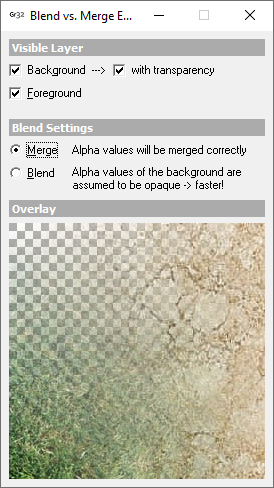 |
| [PixelCombine](./Blending/PixelCombine) | Alpha composition modes. TImage32 layers and blend modes. | 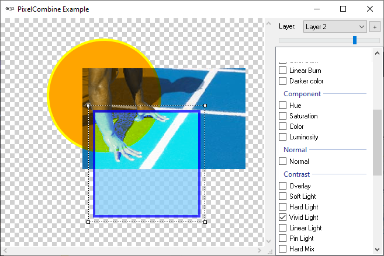 |
| [TextureBlend](./Blending/TextureBlend) | Color algebra composition modes. Custom blend modes. | 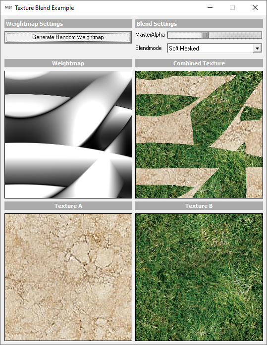 |
| [AntiAliasing](./Drawing/AntiAliasing) | Antialiased lines and polygons. | 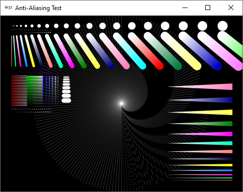 |
| [ArrowHead](./Drawing/ArrowHead) | Polygons. Lines and bezier curves. Arrow heads. Polygon fillers. | 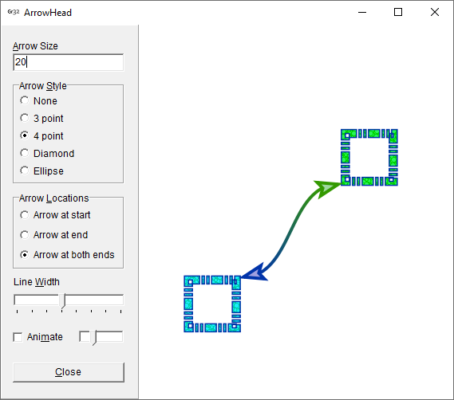 |
| [Benchmark](./Drawing/Benchmark) | Polygon rasterizer benchmark. Compares the performance of different polygon rasterizers. | 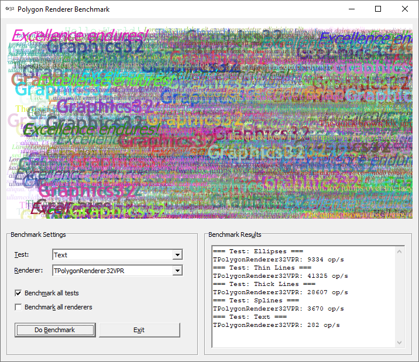 |
| [Blurs](./Drawing/Blurs) | Different blur types: - Gaussian blur - Motion blur - Selective blur - Bokeh blur | 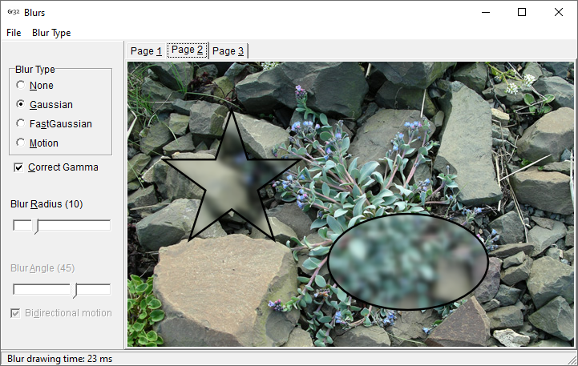 |
| [Clipper](./Drawing/Clipper) | Polygon operations using the [Clipper](https://github.com/AngusJohnson/Clipper2) library integration. | 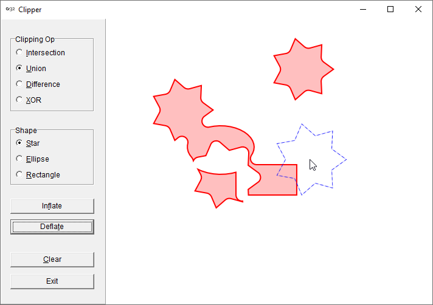 |
| [CubicSpline](./Drawing/CubicSpline) | Manual construction of Cubic Spline Bezier Curves and rendering using the VPR rasterizer. | 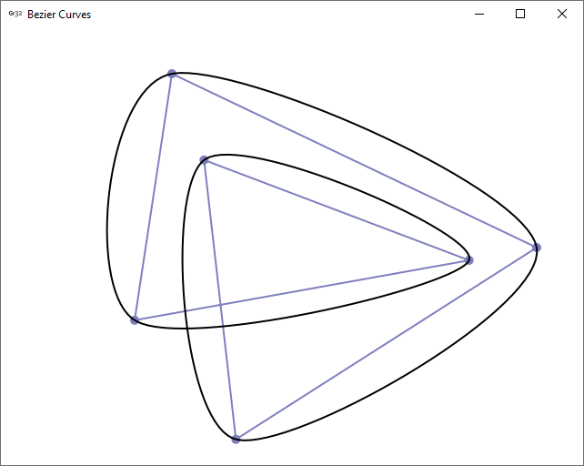 |
| [Curves](./Drawing/Curves) | Manual construction of Spline Curves and rendering using the `TCanvas32` class. | 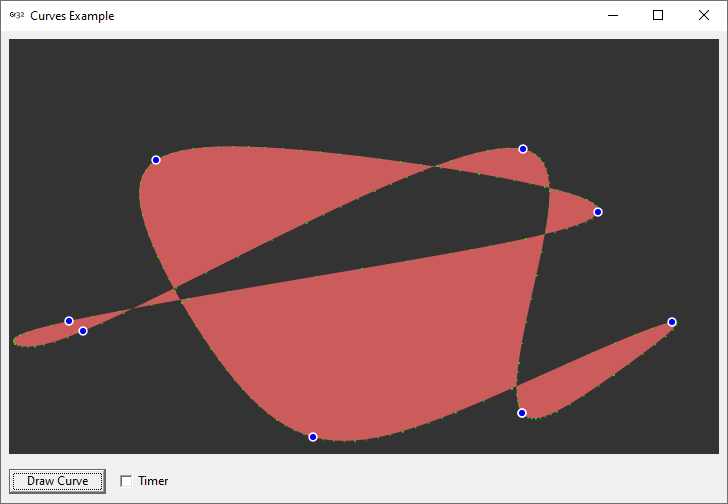 |
| [GammaBlur](./Drawing/GammaBlur) | Blurring with and without gamma correction. | 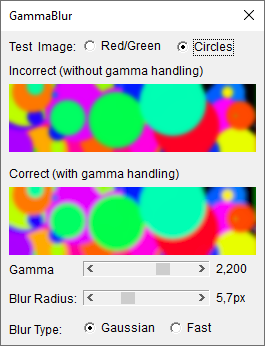 |
| [GammaCorrection](./Drawing/GammaCorrection) | Gamma correction. This example is currently broken. | 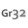 |
| [GradFills](./Drawing/GradFills) | Polygon fillers. Color gradients. | 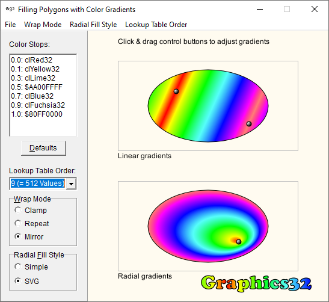 |
| [GradLines](./Drawing/GradLines) | Single pixel gradient lines using stipple patterns. Repaint optimizer. Fading. | 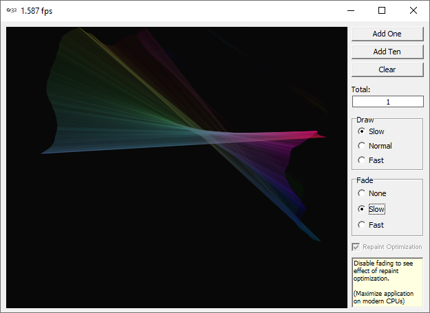 |
| [GradSampler](./Drawing/GradSampler) | Gradient samplers. Polygon fillers. Polygon renderers. | 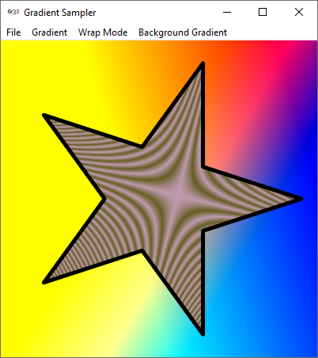 |
| [Grow](./Drawing/Grow) | Polyline builders. | 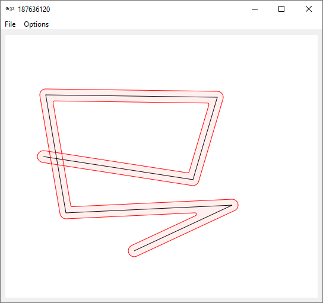 |
| [LineStippling](./Drawing/LineStippling) | Line stipple patterns. | 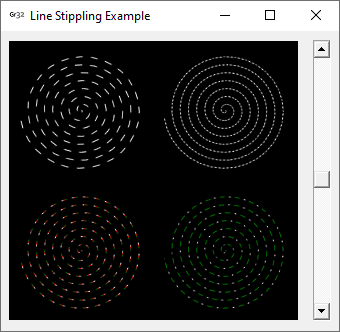 |
| [MeshGradients](./Drawing/MeshGradients) | Mesh gradient samplers. | 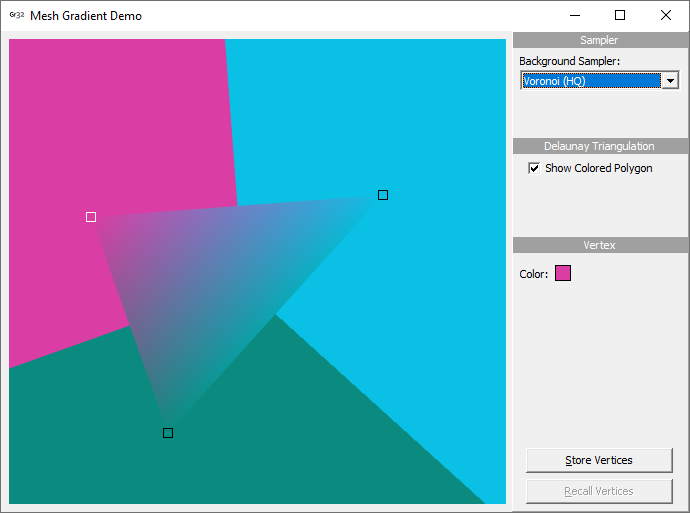 |
| [Polygons](./Drawing/Polygons) | `TCanvas32` Polygon fillers. Stroke and fill brushes. | 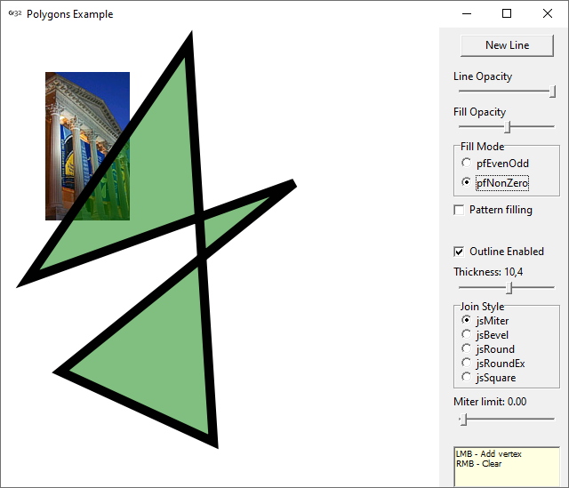 |
| [RenderText](./Drawing/RenderText) | `TCanvas32.RenderText` `TBitmap32.RenderText` | 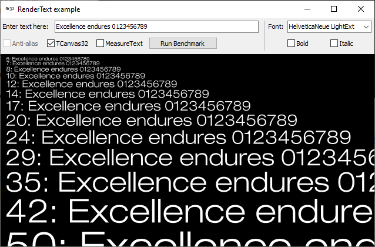 |
| [Rotated text](./Drawing/Rotated%20text) | `TCanvas32.RenderText` Affine transformation. Stroke and fill brushes. |  |
| [ScatterPlot](./Drawing/ScatterPlot) | `TPolygonRenderer32VPR` | 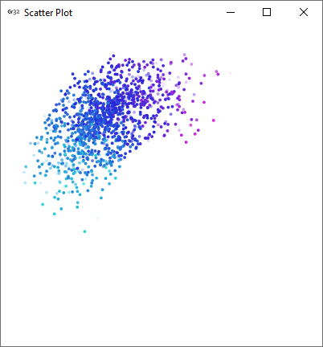 |
| [Swarm](./Drawing/Swarm) | `TPaintBox32` Perlin noise. Animation. Fading. | 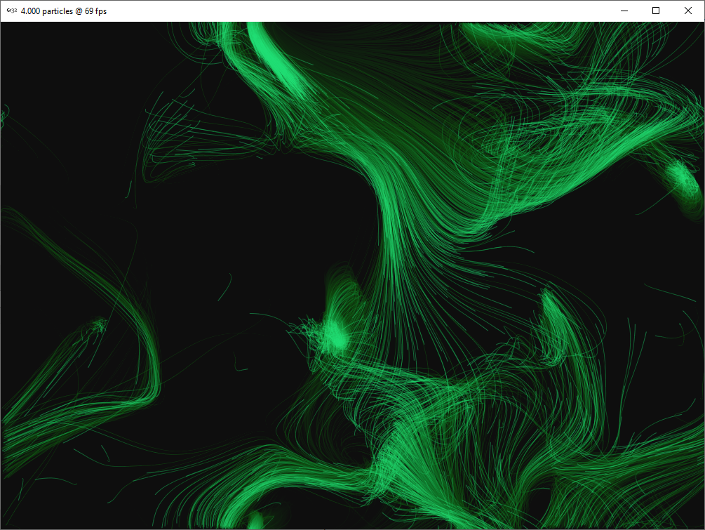 |
| [TextVPR](./Drawing/TextVPR) | Advanced text layout using `TCanvas32.RenderText`. `TPolygonRenderer32VPR` `TPolygonRenderer32LCD` and `TPolygonRenderer32LCD2` (ClearType antialiasing)  | 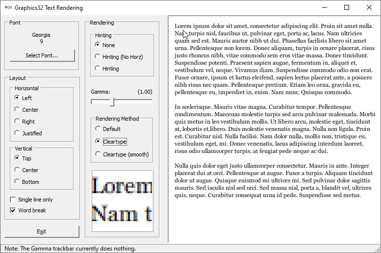 |
| [Thick Lines](./Drawing/Thick%20Lines) | Line drawing benchmark comparing GDI and Graphics32 lines. |  |
| [VertexReduction](./Drawing/VertexReduction) | Polyline simplification using `VertexReduction`. `TCanvas32.PolyLine` Stroke brushes. `TPaintBox32`. | 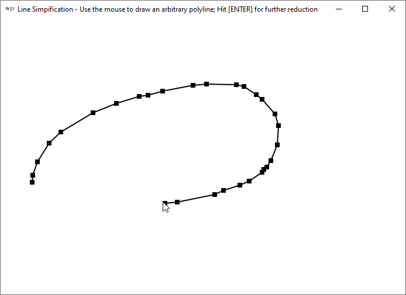 |
| [Bitmap32 to PSD layers](./General/Bitmap32%20to%20PSD%20layers) | Exporting `TBitmap32` to layered PhotoShop (PSD) file. |  |
| [ByteMaps](./General/ByteMaps) | `TImgView32` `TByteMap` `TPalette32`  | 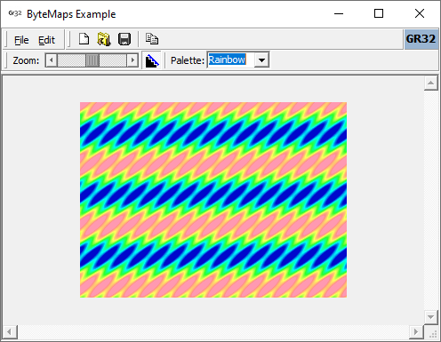 |
| [Color Picker](./General/Color%20Picker) | Graphics32 color picker controls. |  |
| [HoverZoom](./General/HoverZoom) | `TImage32` zooming and panning.  | 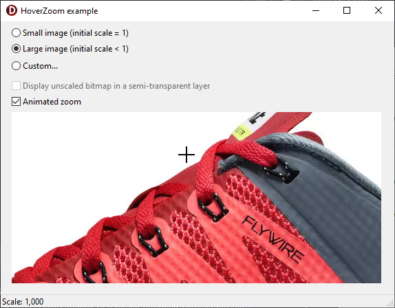 |
| [Image32](./General/Image32) | Various `TImage32` features. | 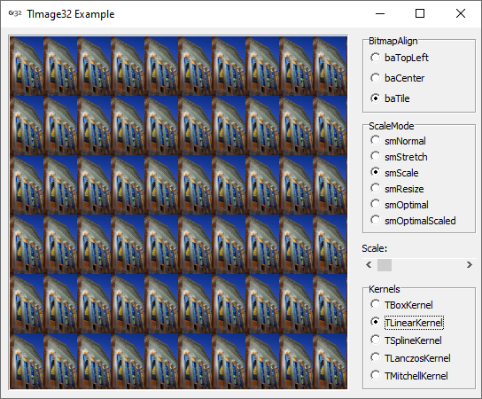 |
| [Image32 background](./General/Image32%20background) | Custom `TImage32` background. |  |
| [Transparent TImage32](./General/Transparent%20Image32) | TImage32 control transparency. Animation. Layers. |  |
| [Mandelbrot](./General/Mandelbrot) | `TSyntheticImage32` Samplers and rasterizers. | 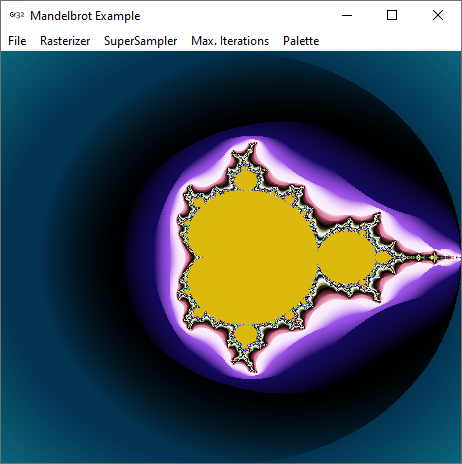 |
| [Optimized repaint](./General/Optimized%20repaint) | Optimized repaint visualizer. |  |
| [PNG Explorer](./General/PNG%20Explorer) | `TPortableNetworkGraphic32` |  |
| [PNG Image32](./General/PNG%20Image32) | Demonstration of PNG support. |  |
| [Pan & Zoom](./General/Pan%20%26%20Zoom) | `TImgView32` and `TImage32` pan and zoom features. |  |
| [Rotate](./General/Rotate) | Bitmap rotation using `TAffineTransformation`. `TImage32` | 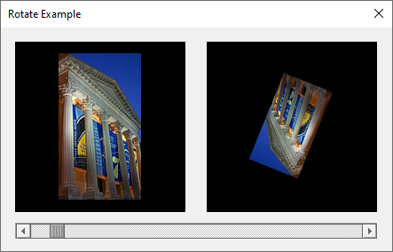 |
| [Transparent form](./General/Transparent%20form) | `TImage32` and layers. Paint tools. |  |
| [Bounce](./Layers/Bounce) | `TImage32` and layers. Easing. Animation. | 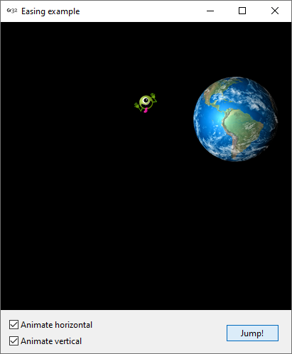 |
| [ImgView_Layers](./Layers/ImgView_Layers) | `TImgView32` and layers. Various layer features. Custom layers. | 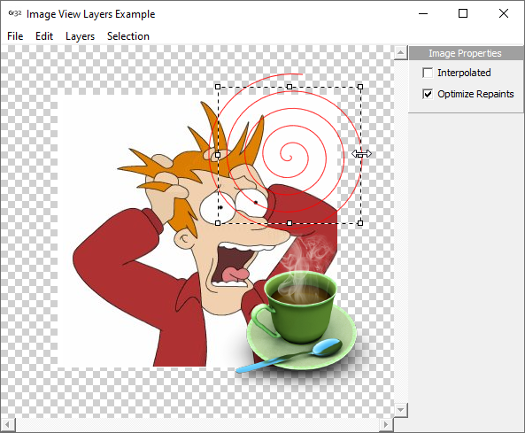 |
| [PSD import export](./Layers/PSD%20import%20export) | Load and save layered PhotoShop (PSD) files. |  |
| [RotLayer](./Layers/RotLayer) | `TImgView32` with custom affine transformation layer. | 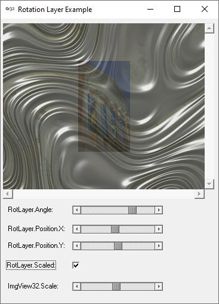 |
| [Sprites](./Layers/Sprites) | `TImage32` with sprite layers benchmark. Optimized repaint. | 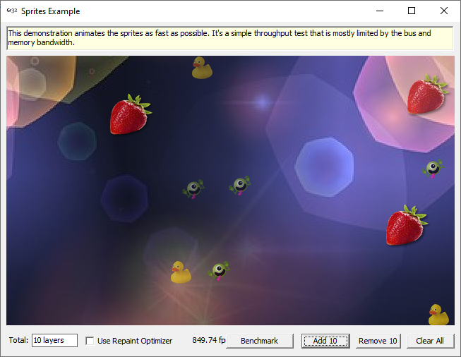 |
| [WaterEffect](./Layers/WaterEffect) | `TImage32` with custom water effect layer. Distortion maps. | 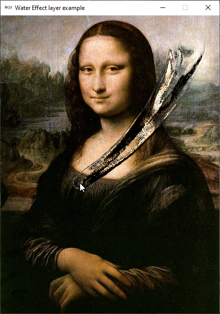 |
| [NestedSampling](./Resampling/NestedSampling) | Nested sampling and rasterizers. | 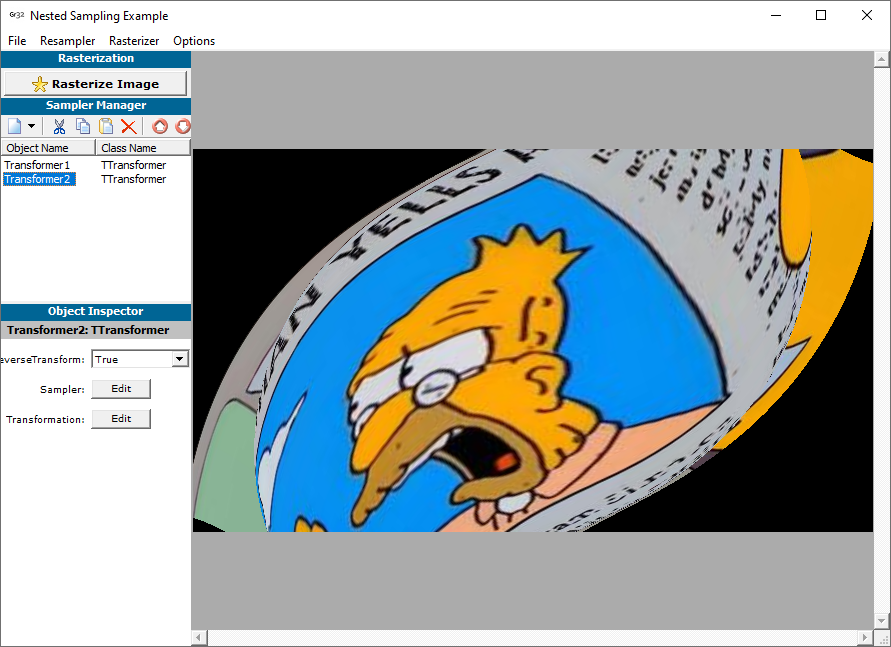 |
| [PixelF](./Resampling/PixelF) | `TBitmap32.PixelF` vs `TBitmap32.PixelFS` `TImage32 ` custom paint stage. | 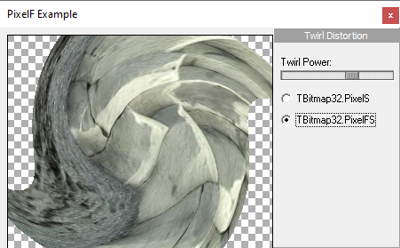 |
| [Resamplers](./Resampling/Resamplers) | Demonstration of the various resamplers and their features. | 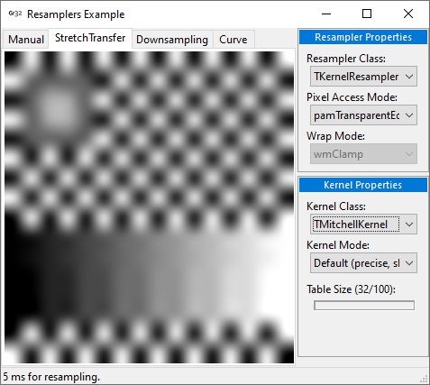 |
| [Resize and Rotate](./Resampling/Resize%20and%20Rotate) | Resizing and rotating a bitmap. The various resamplers and rasterizers. |  |
| [SharpenConvolution](./Resampling/SharpenConvolution) | Sharpen convolution using a kernel sampler. | 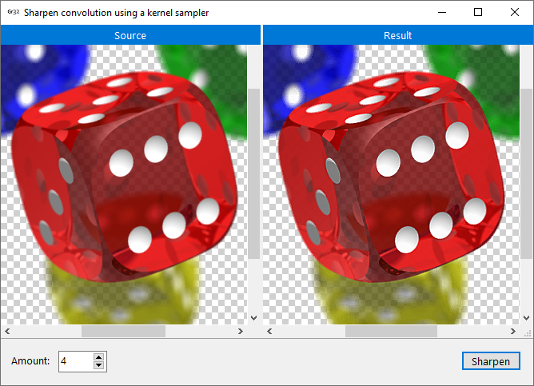 |
| [ImgWarping](./Transformation/ImgWarping) | Image warping using remap transformation. `TPaintBox32` `TImgView32` and custom tool layers. | 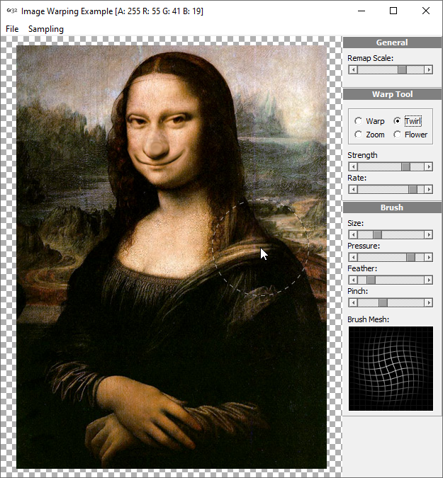 |
| [Perspective Correction](./Transformation/Perspective%20Correction) | Forward projective transformation. `TImage32` and interactive rubber-band layers. Resamplers and rasterizers. |  |
| [Sphere](./Transformation/Sphere) | Spherical projection transformation. Arcball user interface. `TMultithreadedRegularRasterizer` `TDraftRasterizer` | 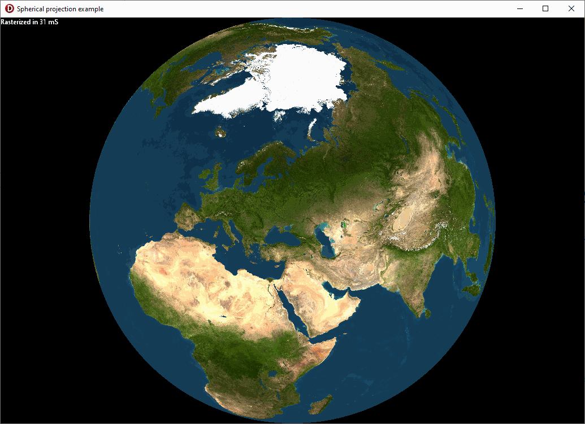 |
| [Transform](./Transformation/Transform) | Various nested affine and projective transformations. | 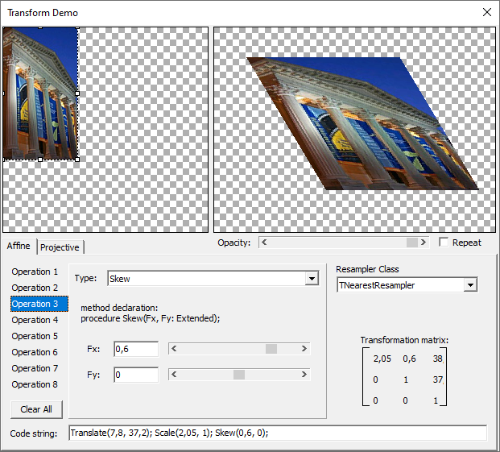 |
| [Visualization](./Transformation/Visualization) | Winamp-style visualization example | 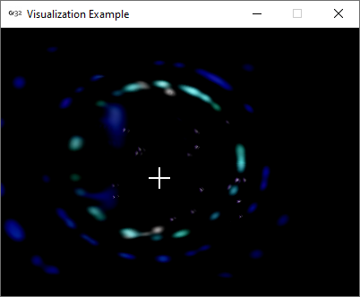 |
